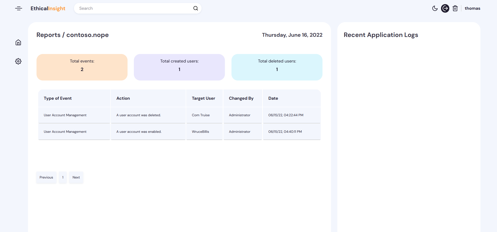
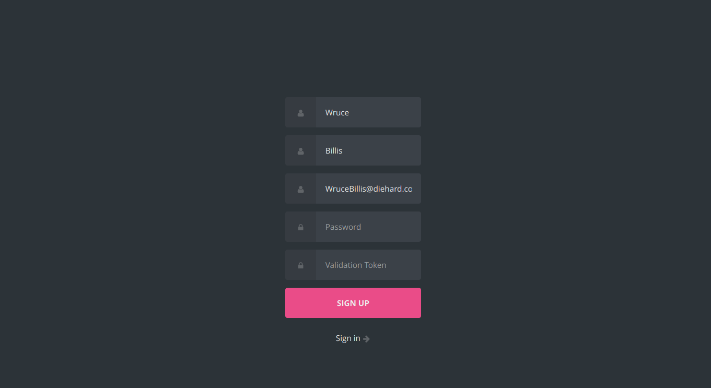
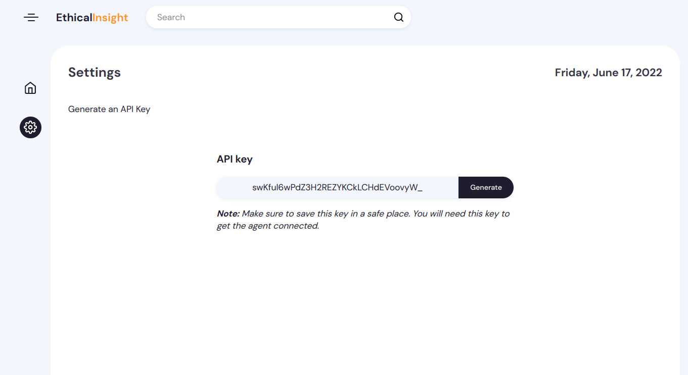
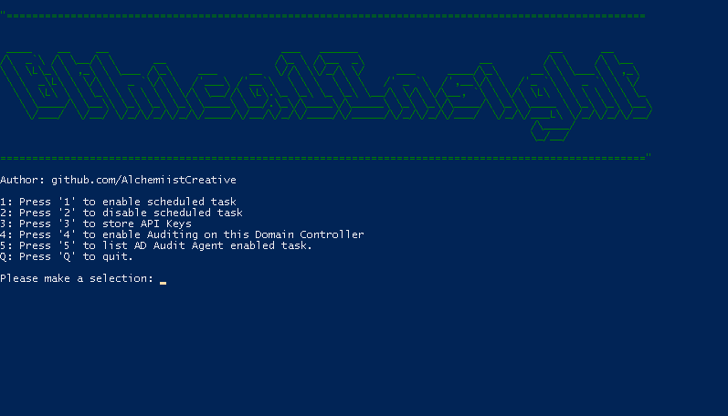
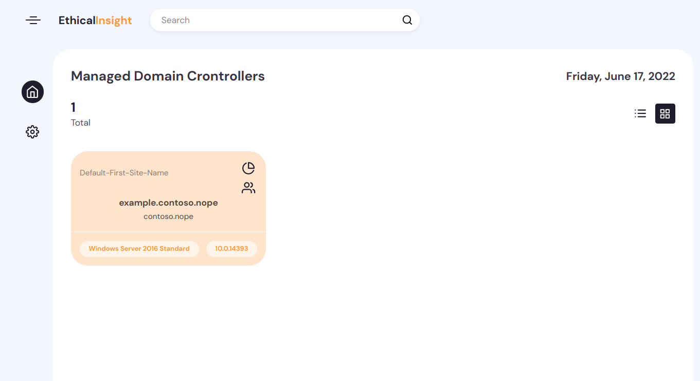

<div id="top"></div>
<div align="center">

<!-- PROJECT LOGO -->


<p>
  
  <a href="#" target="_blank">
    
  </a>
  <a href="https://www.linkedin.com/in/thomasfrancois-cv/" target="_blank">
    
  </a>
</p>
  
  <p align="center">
    <br />
    <a href="https://ethicalinsight.alchemistcreative.cloud/"><strong>Explorar la documentación »</strong></a>
    <br />
    <br />
    <a href="https://github.com/AlchemiistCreative/EthicalInsight/issues">Informar un error</a>
    ·
    <a href="https://github.com/AlchemiistCreative/EthicalInsight/issues">Solicitar una funcionalidad</a>
  </p>

<hr>
</div>
<!-- TABLE OF CONTENTS -->
<details>
  <summary>Índice</summary>
  <ol>
    <li>
      <a href="#about-the-project">Acerca del Proyecto</a>
      <ul>
        <li><a href="#built-with">Construido con</a></li>
      </ul>
    </li>
    <li>
      <a href="#getting-started">Primeros pasos</a>
      <ul>
        <li><a href="#prerequisites">Prerrequisitos</a></li>
        <li><a href="#installation">Instalación</a></li>
      </ul>
    </li>
    <li><a href="#usage">Uso</a></li>
    <li><a href="#contributing">Contribuir</a></li>
    <li><a href="#license">Licencia</a></li>
    <li><a href="#contact">Contacto</a></li>

  </ol>
</details>


<!-- ABOUT THE PROJECT -->
## Acerca del Proyecto
<div align="center">

</div>
<br />

Inicié este proyecto para cubrir algunas necesidades que encontré y poder adaptarlas según mis requerimientos.
Eres libre de <a href="#contributing">contribuir</a> a este proyecto y aportar nuevas funcionalidades.

El proyecto consiste en centralizar la auditoría de uno o varios controladores de dominio de AD. 
Funciona mediante un script de PowerShell como agente en el DC, que envía diversos datos a MongoDB a través de una API REST.
Este proyecto puede desplegarse fácilmente con <a href="#docker">Docker</a>.

<p align="right">(<a href="#top">volver al inicio</a>)</p>


### Construido con


* [Node.js](https://nextjs.org/)
* [Express.js](https://expressjs.com/)
* [MongooseJS](https://mongoosejs.com/)
* [DataTables](https://datatables.net/)

<p align="right">(<a href="#top">volver al inicio</a>)</p>


<!-- GETTING STARTED -->
## Primeros pasos


### Prerrequisitos

Para la parte cliente:

Necesitarás configurar el script de PowerShell en tu(s) Controlador(es) de Dominio.
Puedes encontrarlos en este repositorio: [github.com/AlchemiistCreative/EthicalInsight-Agent](https://github.com/AlchemiistCreative/EthicalInsight-Agent)

Para la parte servidor:

Necesitarás una instancia de MongoDB.

### Instalación


1. Clona el repositorio
   ```sh
   git clone https://github.com/AlchemiistCreative/EthicalInsight.git
   ```
2. Instala los paquetes de NPM
   ```sh
   npm install
   ```
3. Introduce tu configuración en `.env`
   ```js
   PORT=8080
   VALIDATION_TOKEN=0000
   MONGODB_URL="mongodb://example:27017/example-db"
   TOKEN_KEY="random_string"
   ```

<p align="right">(<a href="#top">volver al inicio</a>)</p>


## Uso

### 1. Registro

Crea una cuenta con el token de validación que hayas configurado en el archivo .env.




### 2. Generar una clave API

Genera una clave API en la configuración (asegúrate de guardar esta clave en un lugar seguro, la necesitarás para conectar el agente).



### 3. Ejecutar scripts en el(los) Controlador(es) de Dominio

Ejecuta ethicalinsight-agent.ps1 en tu(s) Controlador(es) de Dominio.



3.1 Clona este repositorio
```powershell
git clone https://github.com/AlchemiistCreative/EthicalInsight-Agent.git
```
3.2 Verifica la política de ejecución para asegurarte de que puedes ejecutar scripts.
```powershell
 Get-ExecutionPolicy
```
Para ejecutar los scripts, la política de ejecución debe ser Unrestricted/Bypass, pero si estás en RemoteSigned, aún puedes copiar el contenido de los scripts y crear nuevos. (Ten cuidado con los nombres de los archivos, deben ser exactamente iguales para que funcionen).

3.3 Ejecuta ethicalinsight-agent.ps1
```powershell
.\ethicalinsight-agent.ps1 #From the correct directory location.
```

Desde este menú debes guardar tu clave API, activar la auditoría y también habilitar la tarea programada.

### 4. Finalizado
Asegúrate de que tu Controlador de Dominio aparezca en la página de inicio; si no es así, consulta el archivo error.log en el directorio de scripts del agente.



<p align="right">(<a href="#top">volver al inicio</a>)</p>


## Docker

1. Modifica las variables de entorno para que se ajusten a tu configuración en docker-compose.yml y ejecuta docker-compose.
   ```bash
   docker-compose up -d
   ```
2. También puedes descargar la imagen y ejecutarla sin docker-compose o construir la imagen de docker desde el Dockerfile en src/Dockerfile
   ```bash
   docker run -d --env-file ./src/.env -p 5000:5000 --name ethicalinsight-server alchemistcreative/ethicalinsight:latest
   ```

<p align="right">(<a href="#top">volver al inicio</a>)</p>
<!-- CONTRIBUTING -->

## Contribuir

Las contribuciones son lo que hacen de la comunidad de código abierto un lugar tan increíble para aprender, inspirarse y crear. Cualquier contribución que hagas será **muy apreciada**.

Si tienes una sugerencia que lo mejore, por favor haz un fork del repositorio y crea un pull request. También puedes simplemente abrir un issue con la etiqueta "enhancement".
¡No olvides darle una estrella al proyecto! ¡Gracias de nuevo!

1. Haz un fork del proyecto
2. Crea tu rama de funcionalidad (`git checkout -b feature/AmazingFeature`)
3. Realiza un commit de tus cambios (`git commit -m 'Add some AmazingFeature'`)
4. Haz push a la rama (`git push origin feature/AmazingFeature`)
5. Abre un Pull Request

<p align="right">(<a href="#top">volver al inicio</a>)</p>


<!-- LICENSE -->
## Licencia

Distribuido bajo la licencia GNU v3. Consulta `LICENSE` para más información.

<p align="right">(<a href="#top">volver al inicio</a>)</p>


<!-- CONTACT -->
## Contacto

Tu Nombre - [@alchmst_](https://twitter.com/alchmst_) - contact@thomasfrancois.net

Enlace del proyecto: [https://github.com/AlchemiistCreative/EthicalInsight](https://github.com/AlchemiistCreative/EthicalInsight)


<p align="right">(<a href="#top">volver al inicio</a>)</p>

<!-- MARKDOWN LINKS & IMAGES -->

[contributors-shield]: https://img.shields.io/github/contributors/AlchemiistCreative/EthicalInsight.svg?style=for-the-badge
[contributors-url]: https://github.com/AlchemiistCreative/EthicalInsight/graphs/contributors
[forks-shield]: https://img.shields.io/github/forks/AlchemiistCreative/EthicalInsight.svg?style=for-the-badge
[forks-url]: https://github.com/AlchemiistCreative/EthicalInsight/network/members
[stars-shield]: https://img.shields.io/github/stars/AlchemiistCreative/EthicalInsight.svg?style=for-the-badge
[stars-url]: https://github.com/AlchemiistCreative/EthicalInsight/stargazers
[issues-shield]: https://img.shields.io/github/issues/AlchemiistCreative/EthicalInsight.svg?style=for-the-badge
[issues-url]: https://github.com/AlchemiistCreative/EthicalInsight/issues
[license-shield]: https://img.shields.io/github/issues/AlchemiistCreative/EthicalInsight.svg?style=for-the-badge
[license-url]: https://raw.githubusercontent.com/AlchemiistCreative/EthicalInsight/main/LICENSE
[linkedin-shield]: https://img.shields.io/badge/-LinkedIn-black.svg?style=for-the-badge&logo=linkedin&colorB=555
[linkedin-url]: https://www.linkedin.com/in/thomasfrancois-cv/
[product-screenshot]: images/screenshot.png
